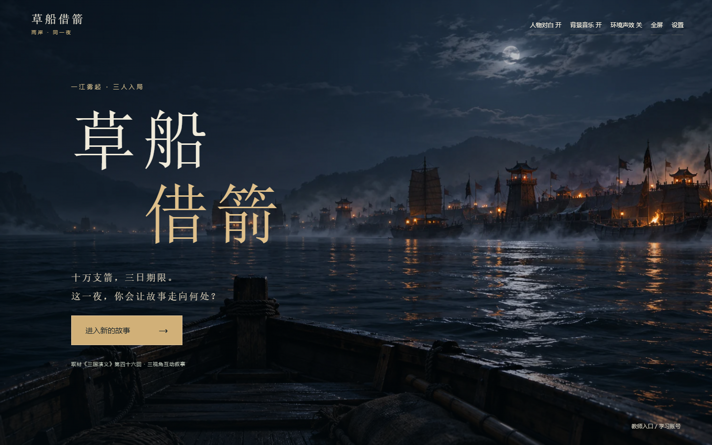

# 草船借箭 · LST

**一江雾起，三人入局。** 从鲁肃、诸葛亮或曹操的处境进入同一夜，布置草船、传递军令、观望江面、承受箭雨、转舷与收队，再回营承担这次选择的结果。

[](https://Royal44-k.github.io/Borrow-Arrow/)
[](https://github.com/Royal44-k/Borrow-Arrow/releases/tag/LST)

**[点击进入在线课件 →](https://Royal44-k.github.io/Borrow-Arrow/)** · **[Windows 离线完整包 →](https://github.com/Royal44-k/Borrow-Arrow/releases/download/LST/Borrow-Arrow-LST-Offline-Windows-x64.zip)** · **[源码与全部素材 →](https://github.com/Royal44-k/Borrow-Arrow/releases/download/LST/Borrow-Arrow-LST-Source-Assets.zip)**



## 如何体验

1. 点击上方“立即体验”，使用桌面版 Edge / Chrome / Firefox。推荐 1440×900 或更大视窗，开启声音。
2. 首页进入故事，观看片头，选择人物与江上情境，再选择体验学生身份。**不用注册、没有密码、无需 API Key。** 第一次入局需加载约 13 MB 本地 Python/WASM 运行器。
3. 按角色推进，体验装配、传号、调船、擂鼓、归岸点验与箭数核对。左侧箭头可回看；从“回望这一夜”选择片段另开推演，原路线仍保留。
4. 完成一条故事路线后可进行 **22 题、满分 100 分**的课题测试：单选、多选、填空、排序、配对、简答、论述与个人感悟。
5. 在设置中退出学生身份，回首页“教师入口 / 学习账号”，选择 T001；可查看**此浏览器**内 S001–S003 的路线、本人表达、帮助记录、答卷和目标观察矩阵，按量规批阅、发布总分并写综合评语。再切回原学生即可看到已发布总分。

**公开体验范围：** 全部剧情与素材在浏览器运行，数据只存当前浏览器的 IndexedDB / localStorage，不发送到仓库或第三方；换电脑、换浏览器、清理网站数据后不会同步。体验账号及教师入口不构成安全认证，请勿填写真实学生身份或隐私信息。公开练习题与答案可从源码查阅，不能直接当作保密考试。真实班级平台应部署下方服务器版并另设题卷。

真实 DeepSeek 调用保持关闭；场内助手使用预写情境提示。公开版客观题采用明确规则计分，表达题须教师按量规批阅后才能发布总分。**不把这称为模型评分，也不把点击、共同通关或游戏得箭数当作学生能力。**

## 离线运行

从 [LST Releases](https://github.com/Royal44-k/Borrow-Arrow/releases/tag/LST) 下载 `Borrow-Arrow-LST-Offline-Windows-x64.zip`，**完整解压**，双击 `启动课件.cmd`。内含 Python 3.12.10 Windows x64 便携运行时，无需安装 Node/Python，也无需联网下载素材。保持启动窗口打开；关闭窗口即停止本机服务。默认端口 8778，若被占用会改用空闲端口。存档按网址与端口分开；使用其他端口不会删除原存档，回到原端口可再次读取。

页面需通过启动器访问，不能直接双击 `site/index.html`：浏览器对 `file://` 下的模块、WASM 和本机存档有限制。macOS/Linux 可在已有 Python 3 环境中运行 `python3 offline-server.py`（同一包的 `site/` 不依赖 Windows）。启动器只监听 `127.0.0.1`，不会开放到局域网。

## 版本与内容

LST 是 2026-11-04 对现有最新 V1.6 课件的整理发布版。**内部剧情版本继续使用 V1.6**，避免仅改名称破坏条件分支与存档逻辑；对外发布名为 LST。本轮主要增加静态网站运行、离线分发、子路径适配与发布说明，不声称重新制作了整套美术。

- 三角色、四种起始江况；既有 71 节点剧情引擎，包含条件分支与独立结尾。
- 写实场景、透明人物、已生成对白、程序环境声、第一人称箭雨、三维草船装配与船队操控。
- 共端操作保留操作者与本人表达归属；回看、分支重演、重新尝试、考试和教师回看。
- 现有全部运行音画、木纹材质、原始 V1.6 绘图、脚本审阅稿、素材来源和校验清单一并保留。

《三国志》的赤壁背景、《三国演义》的借箭情节与本课件改编支线有区别。军令信号为教学约定；岑舟等辅助角色为原创虚构。软件验收不等于真实教学效果研究，未宣称开展真实师生实验。

## 目录与开发

| 目录 | 内容 |
|---|---|
| `src/` | Vue 3 / TypeScript / Three.js 前端 |
| `public/v1…v16/` | 完整可运行音画与材质，包含演进版本中仍有引用的文件 |
| `public/engine/` | 原 Python 剧情和试题 + 浏览器本机 API 适配 |
| `public/runtime/` | 自托管 Pyodide 314.0.7，无运行期 CDN 依赖 |
| `backend/`、`content/` | 原 FastAPI / SQLAlchemy / SQLite 服务器实现与内容 |
| `docs/` | 脚本、素材出处、验收与文件校验清单 |
| `design-assets/` | 最新 23 张原始高分辨率画稿 |
| `scripts/` | 构建、离线包装、校验与浏览器检查 |

需要 Node.js 22.18+，建议使用仓库锁定的 pnpm 依赖：

```sh
corepack enable
pnpm install --frozen-lockfile
pnpm build
pnpm preview
```

默认构建是无需后台的浏览器体验版，GitHub Pages 使用同一套前端及原 Python 剧情引擎。`pnpm test` 是前端单元检查；`python -m pytest tests/test_browser_api.py` 检查浏览器 API 等价路线与存档/考试行为，需另安装 pytest。UI 走查脚本见 `scripts/`，使用 Playwright 与本机 Edge；它们不属于运行依赖。

服务器版部署与账号配置见 [服务器运行说明](docs/server-mode.md)。服务器版需 Python 依赖、账号和本机数据库，不是 GitHub Pages 提供的云端班级服务。本仓库不含已有数据库、登录令牌、模型密钥或真实学情数据。

## 资源与使用说明

[第三方资源及许可](THIRD-PARTY.md) · [发布验收](docs/LST-acceptance.md) · [逐幕脚本](docs/V1.6_新增分支剧本审阅稿.md) · [素材校验](docs/asset-manifest.json)

项目用于计算机本科毕业设计《面向中小学AI+教育案例设计与实现——以趣味流水线交互为例》。公开代码与生成资产不默认授予额外商业转授权；第三方组件按其自身许可使用。参考视频、水印截图、其他平台课件及第三方付费资源不包含在分发包内。

